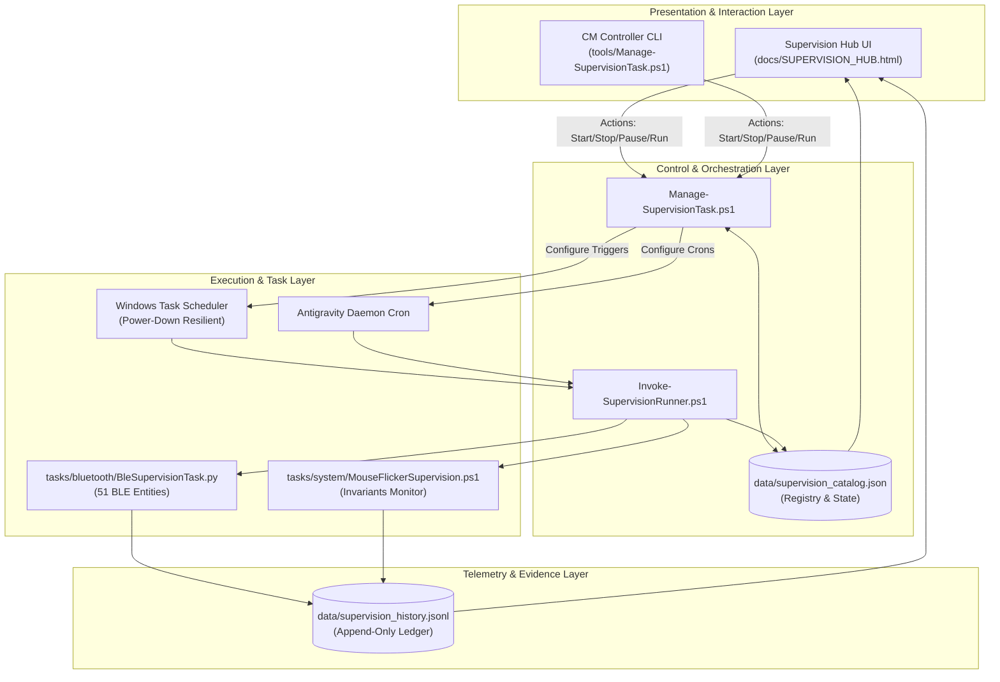

# Architecture Specification: Workspace Supervision Engine

- **Module**: `Workspace_Supervision`
- **Domain**: `Workspace_Supervision`
- **Authors**: Rolf, Workspace_AI Engine
- **Version**: 1.0.1 (LCM Baseline: 7.3.2)
- **Date**: 2026-09-08
- **LCM Status**: Active

---

## 1. System Architecture



---

## 2. Task Lifecycle States

A supervision task moves deterministically through five states:

| State | Badge Color | Description |
| :--- | :--- | :--- |
| **`Active`** | 🟢 Green | Scheduled and executing automatically at its configured interval. |
| **`Paused`** | 🟡 Amber | Temporarily suspended; schedules remain registered but executions are skipped. |
| **`Stopped`** | ⚪ Gray | Fully decommissioned from active scheduling. |
| **`Running`** | 🔵 Blue | Currently in the middle of executing a supervision cycle. |
| **`Failing`** | 🔴 Red | Last cycle encountered unexpected execution errors or critical threshold breaches. |

---

## 3. Standardized Observation Model

Every supervision task produces structured observation telemetry:

```json
{
  "taskId": "ble-fleet-stability",
  "timestamp": "2026-09-01T13:21:58Z",
  "durationSeconds": 2.14,
  "status": "Healthy",
  "counts": {
    "errors": 0,
    "warnings": 0,
    "info": 1,
    "total": 1
  },
  "summary": "Monitored 51 dynamic BLE entities. 0 dropouts, 0 rapid oscillations.",
  "details": []
}
```
