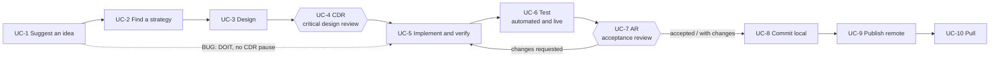

# LCM Use Case Overview

Module: docs/LCM-Use-Case-Overview.md  
Purpose: The ways LCM is used, one use case per section (structured like Apps), starting with the change lifecycle from idea to publish and pull; includes how the AI presents each step to the operator.  
Path: LCM_Supervision/docs/LCM-Use-Case-Overview.md  
Authors: Rolf, Claude  
Version: 10.8.4  
Status: Draft (first draft 2026-11-20; operator request, not yet reviewed)  
Date: 2026-11-20 21:50:00

---

## 1. Purpose and Structure

LCM is used through a small set of use cases. Each use case is described like an App (RULE-DOC-007): the same
sections in the same order, so use cases can be compared, extended and later split into their own documents.

Section template per use case:

| Section | Content |
|:---|:---|
| Goal | what the operator wants to reach |
| Trigger | the operator word or event that starts it |
| Actors | operator, AI host(s), tools |
| Preconditions | lifecycle state and artifacts that must exist |
| Steps | what happens, in order |
| Results | states, records and files afterwards |
| Tools and macros | the governed commands involved |
| Presentation | how the AI reports this step in the chat |
| Example | a real case |

Further usage areas (setup, onboarding, recovery, display use, subsystem work) will be added as their own use cases.

## 2. The Change Lifecycle at a Glance

Lifecycle states (ProposalReviewFlowPolicy): `suggested` (UC-1 to UC-4), `in_progress` (UC-5), `verified` (UC-6),
`in_review` (UC-7), `completed` (UC-8), `pushed` (UC-9).

Gate names (operator 2026-11-20): Gate 1 is the **CDR** (Critical Design Review: the design is frozen and the
build is authorized); Gate 2 is the **AR** (Acceptance Review: the as-built product is accepted; it covers what
configuration management calls the functional and physical configuration audits, FCA / PCA: live tests show it does
what was required, the BCR review shows the as-built matches its documentation). The rules still say "Gate 1" and
"Gate 2"; renaming them is a rule change (ADMINMODE, RULE-AUTH-002) to be proposed.

## 3. Use Cases

### UC-1 Suggest an Idea

- Goal: capture an idea, question or defect without acting on it yet.
- Trigger: `CRP: <text>` or `BUG: <text>`; an AI-found defect in a permanent tool (RULE-LCM-010).
- Actors: operator; AI host registers it.
- Preconditions: none. Before opening a new item the AI checks whether an open item already covers the goal and adds to it instead (efficiency; no new tickets unless unavoidable).
- Steps: register in `proposals.db` (state `suggested`); scaffold the bundle (`Specification`, `Implementation Plan`, `Walkthrough`).
- Results: ledger row, bundle folder.
- Tools and macros: `Update-Proposal.ps1`, `Invoke-ProposalAction.ps1`.
- Presentation: one line with the new ID and state; no plan yet.
- Example: CRP-382 (live data for displays), registered `suggested`, later declared the running task.

### UC-2 Find a Strategy

- Goal: place the item in a larger goal so related items move together.
- Trigger: operator decision, or several items sharing one goal.
- Steps: link the item to a strategy (`strategies`, `strategy_crps`: delivers / aligns); merge or absorb overlapping items.
- Results: strategy links; absorbed remarks quoted in the bundle (RULE-LCM-031).
- Tools and macros: `ShowStrategies`, `Test-LcmStrategyConsistency.ps1`.
- Presentation: which strategy, which items it joins, what was absorbed.

### UC-3 Design

- Goal: a target state the operator can accept before anything is built.
- Steps: Gate 0 Contract (target state, invariants and exit criteria, non-goals; GoalFirstDesignPolicy); analysis artifacts under `data/analysis/<ID>/`; data design with tables and an entity-relationship diagram in `docs/DataDesign-<Domain>.md`; draft first, marked accepted after the operator decision.
- Results: Specification with Gate 0 Contract; data design draft, then accepted.
- Presentation: the design as tables (one row per table or rule) and a diagram preview; real choices as lettered options; obvious choices made by the AI and named in one line.
- Example: CRP-358 ledger without blobs (2026-11-20): column mapping, table design, diagram, text root `docs/Proposals/_blobs/`, accepted after four short rounds.

### UC-4 CDR (Critical Design Review, formerly "Gate 1")

- Goal: the operator freezes the accepted design and authorizes the build.
- Trigger: `Proceed` (stepwise) or `do <ID>` (DOIT: straight through to Gate 2, never past it).
- Preconditions: Specification accepted (the only document that needs formal acceptance).
- Results: state `in_progress`; DOIT flag where given.
- Presentation: none beyond the state line; work starts.

### UC-5 Implement and Verify

- Goal: the accepted target state, built and mechanically sound.
- Steps: changes confined to the Gate 0 clauses; backup before any table restructuring; syntax gates for every changed file (PowerShell parser, `py_compile`, flake8, JSON parse, shell syntax); store integrity checks; defects found on the way recorded in the running item (no separate ticket where the operator accepts them as immediate needs).
- Results: state `verified`; Walkthrough with the path actually taken and the evidence.
- Presentation: what changed (grouped by purpose, not by file), what was found on the way, evidence as numbers (files parsed, tests passed), and anything not checked named explicitly.
- Example: CRP-358 tools step: JSON stores retired, 31 readers and writers switched, one accessor bug found and recovered, two pull/hook defects fixed as immediate needs.

### UC-6 Test (Automated and Live)

- Goal: confidence that the result works in real use.
- Steps: automated tests by the AI (Pester, Python checks, round trips such as dump then restore); live tests by the operator, offered as a tickable list with trampoline names; decisions during testing as prompts with lettered choices.
- Results: test evidence in the Walkthrough; live test results recorded after the operator runs them.
- Presentation: automated results as counts with failures explained (including failures that are not caused by the change); live tests as a checklist.

### UC-7 AR (Acceptance Review, formerly "Gate 2")

- Goal: the operator accepts the change after visual review and live tests.
- Trigger: the AI reaches `verified`; review in the open BCR window (Beyond Compare against the mounted Macrium baseline).
- Steps: review in priority order (the AI ranks the changed documents and files by interest); disposition `accepted`, `accepted with changes`, or changes requested.
- Results: state `in_review`, then the disposition; operator changes applied in one pass.
- Tools and macros: `BCR`; the baseline is never remounted while the review window is open.
- Presentation: a ranked review list ("highest interest" first) with the reason for each rank; files without content change named as skippable.
- Example: BUG-348 accepted; CRP-358 tools step accepted with changes (no `.sql` outside a publish, no blobs, two-way text linkage).

### UC-8 Commit (Local)

- Goal: the accepted change recorded in the repositories, nothing sent out.
- Trigger: `COMPLETE <ID>`.
- Steps: version increment, review receipt, local commit in every changed governed repository; never a push.
- Results: state `completed`; commit IDs per repository.
- Tools and macros: `Complete-Review.ps1`.
- Presentation: commit IDs per repository; what stays uncommitted and why.

### UC-9 Publish (Remote, With Enforcements)

- Goal: the completed state on the remote, reconstructable from Git alone.
- Trigger: `PUBLISH` / `PUSH`.
- Steps: rules export; `.sql` projections written from the databases (the only time they are written); lockstep preflight over the cohort; push; modes reset to their defaults.
- Results: state `pushed`; remote holds code, docs and the `.sql` projections.
- Tools and macros: `Invoke-LCM_Push.ps1` (dry run available, changes nothing).
- Presentation: repositories pushed, skipped, failed.

### UC-10 Pull

- Goal: a working copy whose databases match the pulled state.
- Trigger: `git pull` / checkout on another machine or after a restore.
- Steps: git hooks `post-merge` / `post-checkout` rebuild `proposals.db` (with the strategies) and `tools.db` from their `.sql` projections; the previous database file is kept.
- Results: databases equal to the published state.
- Tools and macros: `sync_proposals_db.py --action hydrate`, `sync_tool_catalog_db.py --action restore`.

## 4. How the AI Presents Work (applies to every use case)

Agreed with the operator 2026-11-20:

- Lead with the outcome in one line (done, decided, blocked), then the details grouped by purpose.
- Tables for designs and mappings; diagrams (Mermaid) for structures, with a preview when asked.
- Evidence as numbers; anything not checked is named, never implied.
- Decisions the AI can make itself are made and named in one line; only real operator decisions are asked, at most 1-3 per turn, as lettered options.
- Review requests come as a ranked list with the reason for each rank.
- Decisions are recorded in the item's bundle in the same turn; superseded decision entries are consolidated on request.
- Wording: rows and columns (not "fields"); plain terms the operator recognizes.
- Each turn ends with a self-contained "Next step" line that restates every open question with its choices; CRP work ends with the status line `crp <ID> <done>, status <state>`.

## 5. Open Items

- When this concept is finished (operator 2026-11-20 21:56:45): update the state transitions to the new terminology: Gate 1 becomes **CDR**, Gate 2 becomes **AR**. Scope: the canonical rules (ProposalReviewFlowPolicy lifecycle and gates, ReviewCommitGovernancePolicy, macro-definitions, DecisionCascadeGovernancePolicy "Gate 2A"), the host adapters (`.claude/rules`, `AGENTS.md` quick reference, Cross-Reference), the ledger and tool texts (`ProposalManager.psm1` transition messages, Control Hub labels, bundle templates). Rule change: ADMINMODE and RULE-AUTH-002 (all sinks in one change set).
- Add the further usage areas as use cases in the same structure (setup, onboarding, recovery, display use, subsystem work).
